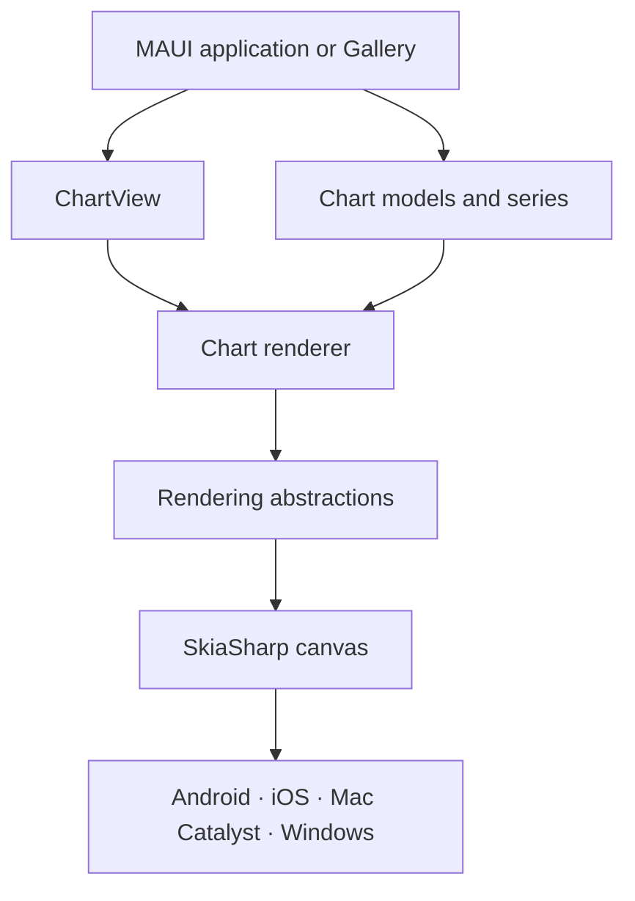

<div align="center">
  
  <h1>ChartNivra</h1>
  <p><strong>Build expressive charts for your .NET MAUI applications.</strong></p>
  <p>One chart library. A practical gallery. Your data on every screen.</p>
  <p>
    
    
    
    <a href="https://www.nuget.org/packages/ChartNivra/1.0.0"></a>
  </p>
</div>

ChartNivra is an in-development charting library for .NET MAUI. It combines chart models, SkiaSharp rendering, a MAUI chart view, and an interactive sample gallery in a single repository. Use the gallery to explore chart types, inspect sample data, and see how each example is configured.

> **Released:** [ChartNivra `1.0.0` is available on NuGet.org](https://www.nuget.org/packages/ChartNivra/1.0.0). Development and cross-platform validation are ongoing.

## Highlights

- **23 chart types in the Gallery:** Explore Cartesian, circular, statistical, financial, gauge, conversion, and 3D visualizations.
- **Cross-platform targets:** Build MAUI applications for Android, iOS, Mac Catalyst, and Windows, with a plain .NET target for models and rendering code.
- **SkiaSharp rendering:** Draw charts through a shared rendering layer and host them in MAUI using `ChartView`.
- **Interactive examples:** Explore real-time data, multiple series, annotations, and a 3D visualization studio.
- **Themes and sample code:** Switch Gallery appearance between light and dark and inspect C# and XAML examples where available.
- **Large-data building blocks:** Use LTTB decimation, a streaming ring buffer, and numeric axis calculations as part of chart workflows.
- **One library project:** Chart types, models, rendering, and MAUI controls live in a single library organized by folders.

Chart behavior and interaction support differ by renderer. Use the Gallery and library source to verify a specific feature before relying on it.

## Chart catalogue

| Family | Gallery examples |
| --- | --- |
| Cartesian | Line, bar/column, area, scatter/bubble, spline/step, range/band, waterfall |
| Circular and hierarchical | Pie, donut/doughnut, sunburst, treemap |
| Statistical and financial | Radar/spider, heatmap, histogram, box plot, candlestick/OHLC, technical indicators |
| Gauges and conversion | Radial gauge, linear/bullet gauge, funnel/pyramid |
| 3D | Column/bar, surface/mesh, scatter/point cloud |

The Gallery also contains five demo cards: streaming, 3D visualization studio, annotations, real-time chart, and multiple series.

## See ChartNivra in action

### Desktop

| Explore the gallery | Inspect a chart and its code |
| --- | --- |
|  |  |
|  |  |


### Mobile

<p>
  
  
  
</p>
<p>
  
  
  
</p>

Screenshots are snapshots of the development Gallery and may not reflect every subsequent change.

## NuGet package

| Item | Details |
| --- | --- |
| Package ID | `ChartNivra` |
| Initial stable version | `1.0.0` |
| Intended targets | .NET 10, Android, iOS, Mac Catalyst, and Windows |
| Package page | [ChartNivra 1.0.0 on NuGet.org](https://www.nuget.org/packages/ChartNivra/1.0.0) |

Install the published package from NuGet.org using any of the following methods.

### .NET CLI

From your MAUI application directory:

```sh
dotnet add package ChartNivra --version 1.0.0
```

### Visual Studio

Open **Manage NuGet Packages** for your MAUI project, select **nuget.org**, search for `ChartNivra`, and install version `1.0.0`.

### PackageReference

```xml
<ItemGroup>
  <PackageReference Include="ChartNivra" Version="1.0.0" />
</ItemGroup>
```

The MAUI application also needs the SkiaSharp MAUI registration shown below. The existing [PackageSmoke project](tests/ChartNivra.PackageSmoke/README.md) demonstrates consuming the locally generated preview package; it is separate from the Gallery's project reference. Normal builds do not generate or publish a NuGet package.

## Quick start

### 1. Register SkiaSharp

In `MauiProgram.cs`, add the SkiaSharp MAUI namespace and initialize it when configuring your app:

```csharp
using SkiaSharp.Views.Maui.Controls.Hosting;

builder
    .UseMauiApp<App>()
    .UseSkiaSharp();
```

### 2. Add a chart host

Add `ChartView` to a MAUI page. Replace `MyApp.SamplePage` with your page's actual namespace and class name.

```xml
<?xml version="1.0" encoding="utf-8" ?>
<ContentPage xmlns="http://schemas.microsoft.com/dotnet/2021/maui"
             xmlns:x="http://schemas.microsoft.com/winfx/2009/xaml"
             xmlns:charts="clr-namespace:ChartNivra.Maui.Controls;assembly=ChartNivra"
             x:Class="MyApp.SamplePage">
    <charts:ChartView x:Name="chartView" HeightRequest="320" />
</ContentPage>
```

### 3. Configure the series

In `SamplePage.xaml.cs`, after `InitializeComponent()`:

```csharp
using ChartNivra.Core.Primitives;
using ChartNivra.Core.Series;

chartView.Title = "Revenue";
chartView.Model.Series.Add(new LineSeriesModel
{
    Title = "Revenue",
    Color = ChartColor.FromHex("#00C096"),
    ShowMarkers = true,
    Points = [new(0, 28), new(1, 43), new(2, 36), new(3, 62)]
});
```

See the [Gallery project](samples/ChartNivra.Gallery/README.md) for additional chart families and data examples.

## Architecture

ChartNivra separates chart data and configuration from the code that draws it. MAUI hosts the renderer, while the Gallery supplies sample models and data.



| Layer | Responsibility |
| --- | --- |
| **Core** | Primitives, chart models, axes, series, themes, transforms, and data structures. |
| **Chart families** | Models and algorithms for financial, statistical, circular, gauges, 3D, and other charts. |
| **Rendering** | Renderer and canvas abstractions, with SkiaSharp implementations for drawing. |
| **MAUI** | `ChartView` hosts the selected renderer and responds to chart and theme changes. |
| **Gallery and package test** | Sample applications demonstrate project-reference and package-reference usage. |

These are folders and responsibilities within the current solution, not separate NuGet packages.

## Repository

| Project or folder | Purpose |
| --- | --- |
| [`src/ChartNivra`](src/ChartNivra/) | ChartNivra library and MAUI control. |
| [`samples/ChartNivra.Gallery`](samples/ChartNivra.Gallery/) | Interactive development Gallery. |
| [`tests/ChartNivra.Tests`](tests/ChartNivra.Tests/) | Consolidated xUnit tests. |
| [`tests/ChartNivra.PackageSmoke`](tests/ChartNivra.PackageSmoke/) | Gallery copy that consumes a local preview package. |
| [`benchmarks/ChartNivra.Benchmarks`](benchmarks/ChartNivra.Benchmarks/) | BenchmarkDotNet measurements of selected core operations. |
| [`docs/site`](docs/site/) | Static documentation website. |
| [`images`](images/) | Gallery screenshots. |

## Develop and run the Gallery

You need the .NET 10 SDK, the MAUI workloads for your target, and the relevant platform tools. Android requires the Android SDK; iOS and Mac Catalyst require a Mac with compatible Xcode and .NET workloads. Physical iOS devices also need signing and provisioning.

Open `ChartNivra.slnx` and select **ChartNivra.Gallery** as the startup project, or build from the repository root:

```sh
# Windows
dotnet build samples/ChartNivra.Gallery/ChartNivra.Gallery.csproj -f net10.0-windows10.0.19041.0

# Android
dotnet build samples/ChartNivra.Gallery/ChartNivra.Gallery.csproj -f net10.0-android

# Mac Catalyst, on a Mac
dotnet build samples/ChartNivra.Gallery/ChartNivra.Gallery.csproj -f net10.0-maccatalyst
dotnet build samples/ChartNivra.Gallery/ChartNivra.Gallery.csproj -f net10.0-maccatalyst -t:Run
```

The solution includes PackageSmoke, which needs the local preview package available before a full solution restore. See the [package test instructions](tests/ChartNivra.PackageSmoke/README.md).

## Tests and benchmarks

```sh
dotnet test tests/ChartNivra.Tests/ChartNivra.Tests.csproj
dotnet run -c Release --project benchmarks/ChartNivra.Benchmarks/ChartNivra.Benchmarks.csproj -- --filter "*"
```

The test project includes unit, rendering, integration, and other headless checks; device and UI testing are still required. Benchmark results are machine-specific and do not measure complete chart rendering or mobile responsiveness. See the [test](tests/ChartNivra.Tests/README.md) and [benchmark](benchmarks/ChartNivra.Benchmarks/README.md) guides.

## Ongoing validation

Further package-consumer and device testing, chart example verification, and investigation of the Android build warning about SkiaSharp's 16 KB native page alignment are still needed. Windows, Android, and Mac Catalyst have been exercised during development; iOS and a broader device and chart regression matrix still need verification. A previous automated test run in this environment could not connect to its test host.

The documentation site's Gallery data is generated from the sample app with `python tools/sync_gallery_site.py`. Rerun it when Gallery cards or displayed snippets change.

## License

The library project declares `MIT` as its package license expression. Confirm that the repository includes the intended license text before distributing the package.
